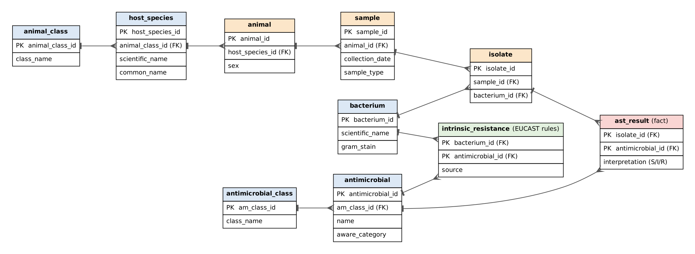

# AMR Surveillance Data Model

A normalised (3NF) relational data model for clinical microbiology and antimicrobial susceptibility testing (AST) data, built in SQL.

It models a typical veterinary AMR surveillance workflow: animals are sampled, bacteria are isolated, and each isolate is tested against a panel of antimicrobials. **All data in this repository is synthetic** and is not taken from any real study.

## Why this project

In AMR surveillance, applying EUCAST expected (intrinsic) resistance exclusions can substantially change multidrug-resistance (MDR) estimates. The rules matter as much as the data. This model stores those scientific rules as data, so corrected results are derived automatically instead of being hard-coded in spreadsheets.

## Data model

**Grain of the fact table (`ast_result`):** one isolate × one antimicrobial tested.

| Layer | Tables | Purpose |
|---|---|---|
| Core | `animal`, `sample`, `isolate`, `ast_result` | What was sampled, what grew, how it responded |
| Reference | `animal_class`, `host_species`, `bacterium`, `antimicrobial_class`, `antimicrobial` | Controlled vocabularies, including WHO AWaRe category |
| Rules | `intrinsic_resistance` | EUCAST expected resistant phenotypes (bacterium × antimicrobial) |

### Key design decisions
- **Normalised to 3NF.** Each fact is stored once. For example, an antimicrobial's class and AWaRe category live only in `antimicrobial`, not repeated on every test result.
- **Rules as reference data.** Intrinsic resistance is a table, not a filter written into each query. If EUCAST updates its expected phenotypes, only that table changes.
- **Constraints protect data quality.** Primary and foreign keys, `UNIQUE`, `NOT NULL` and `CHECK` constraints (for example, interpretation must be S, I or R).
- **Analytics through views.** `ast_corrected` removes intrinsic resistance; `isolate_mdr` applies the Magiorakos et al. (2012) MDR definition (non-susceptible to at least one agent in three or more antimicrobial classes).

## Queries
0. Readable results: joins turn ID numbers into names
1. MDR rate by animal class
2. Resistance percentage per antimicrobial and AWaRe category
3. Raw versus corrected resistant results (impact of the EUCAST correction)
4. Resistance trend per AWaRe category per year, using a CTE and window functions (`RANK`, `LAG`)

## How to run
Everything is in one script, `amr_full_project.sql`. It builds the tables, loads synthetic data, creates the views and contains the queries. It is safe to re-run.

1. Open [sqliteonline.com](https://sqliteonline.com) and choose **SQLite**.
2. Paste the whole script and click **Run**.
3. Highlight one query at a time (Q0 to Q4) and click **Run** to see its results.

## Possible extensions
- Add MIC values and breakpoint versions to `ast_result`
- A star schema version for dashboards (fact table plus date, host and antimicrobial dimensions)
- Load a public AMR dataset

## Author
Hunain Fatima · MSc Zoonoses and One Health (UAB)
